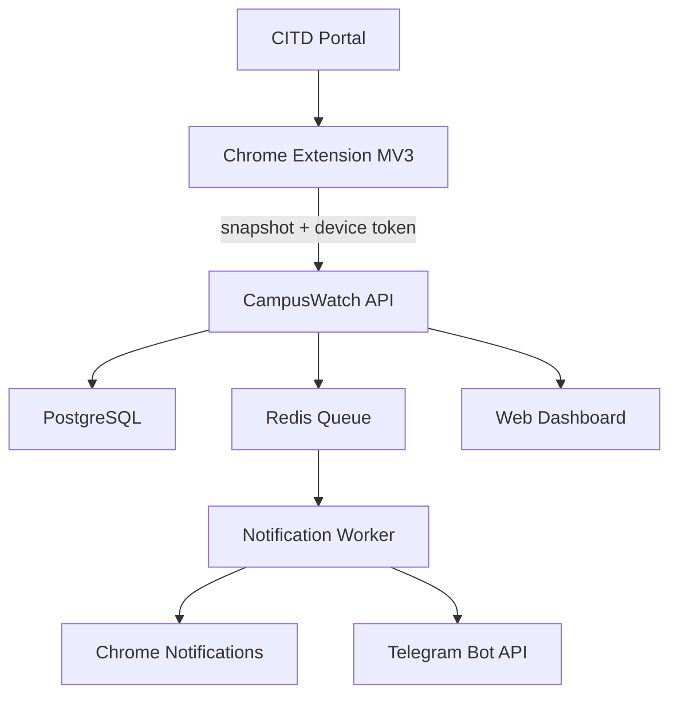

# CampusWatch — Official Implementation Plan

**Phiên bản:** 1.0  
**Căn cứ:** Portal Discovery CITD ngày 11/11/2026  
**Trạng thái:** Sẵn sàng triển khai Giai đoạn 1 (Extension-first)  
**Phạm vi sản phẩm:** Nhiều sinh viên cài Chrome Extension, kết nối Portal đã đăng nhập của chính họ và nhận thông báo khi dữ liệu học tập thay đổi.

## 1. Quyết định kiến trúc

CampusWatch sẽ khởi đầu bằng mô hình **Extension-first + shared Backend**:

- Sinh viên đăng nhập Portal CITD theo cách bình thường trên Chrome.
- Extension chỉ đọc các trang đã đăng nhập của sinh viên đó, trích xuất và chuẩn hoá dữ liệu.
- Extension gửi snapshot/delta qua HTTPS tới CampusWatch API của chính sinh viên đó.
- Backend lưu lịch sử, tính thay đổi, phân phối Chrome/Telegram notifications và bảo đảm dữ liệu không lẫn giữa sinh viên.
- Backend **không lưu mật khẩu, cookie hoặc CSRF token Portal** ở MVP.

Đây là điểm quan trọng: CampusWatch MVP theo dõi định kỳ **khi Chrome đang chạy**. Không hứa “24/7 khi tắt máy” cho đến khi có quyền và bằng chứng kỹ thuật cho Cloud Poller.

## 2. Phạm vi bản 1.0

### Có trong bản 1.0

1. Kết quả học tập: điểm thành phần, điểm học phần, GPA/tín chỉ.
2. Học phí: phải đóng, đã đóng, còn nợ, hạn nộp, trạng thái đúng hạn/trễ hạn, chi tiết môn.
3. Thời khóa biểu: lớp/môn, lịch, thời gian, giảng viên, loại học phí.
4. Lịch thi: ngày, ca, phòng, học kỳ/năm học; hỗ trợ trạng thái chưa có lịch.
5. Popup thông báo trên Dashboard khi Portal hiển thị; đây là nguồn thông báo CITD duy nhất đã xác minh.
6. Change history trong Extension và/hoặc Web Dashboard.
7. Chrome Notification, Telegram Notification, cài đặt loại thông báo và quiet hours.
8. Multi-user isolation, consent, xóa kết nối và xóa dữ liệu.

### Không đưa vào bản 1.0

- Đăng ký/rút học phần, thanh toán, sửa dữ liệu Portal, đổi mật khẩu hoặc thao tác ghi khác.
- Thu thập mọi thông báo từ CITD khi chưa có nguồn thông báo đã xác minh.
- Cloud polling, lưu credential Portal, đọc cookie Portal hoặc đăng nhập tự động từ server.
- Firefox/Edge/Safari; chỉ Chrome trước.

## 3. Mục tiêu nghiệm thu

| Mục tiêu | Tiêu chí đạt |
|---|---|
| Đa sinh viên | User A không thể đọc, gọi API hay nhận thông báo dữ liệu User B; có test tự động chứng minh. |
| Theo dõi | Khi Chrome chạy, alarm quét xấp xỉ 30 phút một lần với jitter; phát hiện add/update/remove hợp lệ. |
| Không lộ Portal secret | Không có password, cookie, CSRF token, HTML thô trong Backend DB, logs, telemetry hay Telegram. |
| Không báo trùng | Cùng một thay đổi chỉ tạo một Change Event/notification dù extension retry hoặc mở nhiều tab. |
| Khôi phục | Session Portal hết hạn được báo rõ “Cần đăng nhập lại”; không retry vô hạn. |
| Minh bạch | Onboarding nói rõ giới hạn khi Chrome/máy tắt và nguồn dữ liệu đang hỗ trợ. |

## 4. Kiến trúc tổng thể



### Thành phần và trách nhiệm

| Thành phần | Công nghệ mặc định | Trách nhiệm |
|---|---|---|
| `apps/extension` | WXT + React + TypeScript, Manifest V3 | Onboarding, alarm 30 phút, content scripts, DOM collectors, local cache, Chrome Notifications. |
| `apps/api` | NestJS + Fastify + OpenAPI | Auth CampusWatch, ingest snapshot, diff, history, settings, Telegram linking. |
| `apps/worker` | NestJS worker + BullMQ | Fan-out notification, retry, quiet hours, cleanup/retention jobs. |
| `packages/contracts` | TypeScript + Zod | Request/response contracts và normalized portal entities dùng chung. |
| `packages/portal-core` | TypeScript thuần | Adapter contract, normalizer, fingerprint, diff engine, fixtures. |
| PostgreSQL | PostgreSQL 16 | User, device, snapshot, entity, change history, Telegram link, audit metadata. |
| Redis | Redis 7 | Queue, rate limit, idempotency, delayed jobs. |
| Observability | Sentry + structured logs | Lỗi đã scrub dữ liệu nhạy cảm, health, selector/schema drift. |

**Lý do chọn:** WXT làm Chrome Extension MV3 nhanh và dễ tổ chức; NestJS phù hợp API/worker nhiều module; PostgreSQL hợp với dữ liệu quan hệ, lịch sử và ràng buộc ownership. Có thể thay nhà cung cấp hosting sau, nhưng không thay contract/domain model.

## 5. User journey đa sinh viên

1. Sinh viên cài Extension từ Chrome Web Store hoặc bản pilot.
2. Mở Extension, tạo/đăng nhập **CampusWatch account** bằng email magic-link hoặc email/password.
3. Xem consent: dữ liệu nào được đọc, chu kỳ 30 phút, giới hạn khi Chrome tắt, retention và cách xóa.
4. Mở Portal CITD, tự đăng nhập. Extension phát hiện session hợp lệ bằng một trang đọc-only.
5. Sinh viên bấm **Kết nối Portal**; Extension chạy initial sync, hiển thị dữ liệu đã nhận và thời điểm quét gần nhất.
6. Sinh viên tùy chọn liên kết Telegram bằng mã một lần; không nhập bot token/chat ID vào Extension.
7. Khi dữ liệu thay đổi, Backend tạo change event rồi gửi đúng kênh người dùng đã bật.
8. Sinh viên có thể Pause, Disconnect Portal hoặc Delete all data bất kỳ lúc nào.

## 6. Thiết kế Extension

### 6.1 Quyền Manifest tối thiểu

| Mục đích | Quyền |
|---|---|
| Chạy scheduler | `alarms` |
| Thông báo local | `notifications` |
| Lưu access token/settings không nhạy cảm | `storage` |
| Mở/đọc tab Portal hợp lệ | `tabs`, `scripting` |
| Chỉ host Portal CITD | `host_permissions: https://portal.citd.edu.vn/*` |

Không yêu cầu `cookies`, không yêu cầu quyền truy cập tất cả website, không gửi DOM/HTML thô ra ngoài.

### 6.2 Modules

| Module | Nhiệm vụ |
|---|---|
| Popup UI | Trạng thái kết nối, lần sync cuối, lỗi session, số thay đổi mới, nút sync thủ công/Pause. |
| Options page | Consent, loại dữ liệu, tần suất, quiet hours, Telegram link, disconnect/delete. |
| Service worker | Chrome alarms, jitter, retry ngắn, đảm bảo một sync/device, gửi snapshot API. |
| Tab orchestrator | Chỉ dùng tab Portal khi có session; inject collector, timeout, đóng tab do Extension tạo sau khi đọc xong. |
| CITD content collectors | DOM parser cho dashboard, grades, timetable, exams, tuition; không có selector lẫn vào core domain. |
| Local cache | `lastFingerprint`, last sync status, pending upload outbox; không lưu raw data lâu hơn cần thiết. |
| Notifications | Tạo Chrome notification khi Backend trả về change event chưa được hiển thị. |

### 6.3 Scheduling

- Alarm nominal: 30 phút.
- Jitter: ngẫu nhiên ±3 phút theo device để tránh mọi sinh viên đánh Portal cùng một giây.
- Không chạy song song: lock per device + `syncRunId`.
- Network/Portal lỗi: exponential backoff, tối đa 3 retry trong 2 giờ; sau đó báo health state.
- Login expired/challenge: dừng polling và báo người dùng mở Portal đăng nhập lại.
- Manual sync: rate-limit, ví dụ tối đa 1 lần/5 phút/device.

## 7. CITD Portal Adapter

Adapter chỉ hỗ trợ đọc. Mỗi collector trả về dữ liệu chuẩn hoá, không trả về DOM, cookie hay token.

```text
PortalAdapter
 ├── capabilities()
 ├── probeSession()
 ├── collectGrades()
 ├── collectTuition()
 ├── collectTimetable()
 ├── collectExams()
 ├── collectDashboardNotices()
 ├── normalize()
 ├── fingerprint()
 └── classifyError()
```

### Entity chuẩn

| Entity | `external_key` đề xuất | Trường cần so sánh |
|---|---|---|
| `grade_course` | năm học + học kỳ + mã môn + lớp nếu có | TH, QT, GK, CK, điểm học phần, tín chỉ, tên môn. |
| `grade_summary` | năm học + học kỳ / cumulative | GPA, tín chỉ đã học/tích lũy. |
| `tuition_term` | năm học + học kỳ | học phí, nợ trước, phải đóng, đã đóng, còn nợ, hạn nộp, trạng thái. |
| `tuition_course` | năm học + học kỳ + mã lớp | môn, tín chỉ, loại học phí. |
| `timetable_class` | năm học + học kỳ + mã lớp | ngày/thứ, giờ, ngày bắt đầu/kết thúc, giảng viên. |
| `exam` | năm học + học kỳ + mã môn + ngày/ca | ngày/giờ/ca/phòng, môn/lớp. |
| `portal_notice` | hash tiêu đề + nội dung + source | popup dashboard hiện thấy. |

### Quy tắc diff

1. Canonicalize: trim, Unicode normalize, date ISO 8601, số tiền integer VND, điểm numeric hoặc `null`.
2. Hash `entity_type + external_key + canonical_payload` bằng SHA-256.
3. So snapshot mới với trạng thái canonical gần nhất của **cùng user + same adapter**.
4. Tạo `ADDED`, `UPDATED`, `REMOVED`; payload diff chỉ chứa trường đổi.
5. Gán `idempotency_key = user + entity + external_key + new_fingerprint`.
6. Không tạo notification cho thay đổi thứ tự dòng, khoảng trắng hoặc timestamps thu thập.

## 8. Backend và API contract

### Modules backend

| Module | Nhiệm vụ |
|---|---|
| Identity | CampusWatch auth, access/refresh token, email verification, recovery. |
| Devices | Đăng ký Extension device, revoke device, version/update policy. |
| Portal connections | Trạng thái kết nối, adapter, consent version, last healthy sync; không chứa credential Portal. |
| Snapshot ingest | Validate Zod schema, authenticate device, size limit, idempotency, transaction ingest. |
| Diff/history | Upsert canonical entities, create Change Event, query history theo user. |
| Notification preferences | Per type/channel, quiet hours/timezone, de-dup window. |
| Telegram | One-time linking, encrypted chat identifier, unlink, webhook verification. |
| Privacy | Export/delete job, consent audit, retention purge. |
| Admin operations | Chỉ aggregate health/adapter version/error code; không xem nội dung học tập mặc định. |

### Endpoint nhóm

| Nhóm | Endpoint tiêu biểu | Quyền |
|---|---|---|
| Auth | `POST /auth/*` | Public/own account |
| Device | `POST /devices/register`, `DELETE /devices/:id` | Own account |
| Connection | `POST /portal-connections`, `POST /portal-connections/:id/probe`, `DELETE /portal-connections/:id` | Owner |
| Sync | `POST /sync-runs`, `POST /sync-runs/:id/snapshot` | Device token + owner binding |
| History | `GET /changes`, `GET /entities/:type` | Owner only |
| Preferences | `GET/PUT /notification-preferences` | Owner only |
| Telegram | `POST /telegram/link/start`, `POST /telegram/link/confirm`, `DELETE /telegram/link` | Owner only |
| Privacy | `POST /privacy/export`, `DELETE /privacy/data` | Owner only, re-auth required |

Không bao giờ nhận `userId` do Extension tự gửi để quyết định ownership. Backend lấy owner từ access/device token và kiểm tra connection thuộc owner trong mọi query.

## 9. Data model và isolation

| Bảng | Khoá/ràng buộc quan trọng |
|---|---|
| `users` | `id`, email unique, status, created_at. |
| `devices` | `user_id`, device public id unique, version, revoked_at. |
| `portal_connections` | `user_id`, adapter key, status, consent_version, last_sync_at; unique `(user_id, adapter_key)`. |
| `sync_runs` | `connection_id`, device_id, status, started/finished; idempotency key unique. |
| `entities` | `connection_id`, entity_type, external_key, canonical JSON, fingerprint; unique `(connection_id, entity_type, external_key)`. |
| `entity_versions` | Snapshot lịch sử tối thiểu cho audit/change view, không lưu secret. |
| `change_events` | `connection_id`, entity key, kind, field diff, notified flags; unique idempotency key. |
| `notification_preferences` | `user_id`, category, channel, enabled, quiet-hours/timezone. |
| `telegram_links` | `user_id` unique, encrypted chat id, verified_at, revoked_at. |
| `consent_audits` | `user_id`, policy version, granted/revoked at. |

Enforce bằng cả 3 lớp: foreign keys + query scope server-side + integration tests của User A/User B. Nếu dùng Postgres RLS, áp dụng bổ sung, không thay cho authorization layer.

## 10. Telegram và Chrome Notifications

### Telegram link flow

1. User bấm “Liên kết Telegram” trong Extension/Web Dashboard.
2. Backend tạo nonce dùng một lần, TTL 10 phút, gắn user hiện tại.
3. User mở bot qua deep link và gửi `/start <nonce>`.
4. Webhook Backend xác minh bot secret, match nonce, mã hoá chat identifier, đánh dấu linked.
5. Không bao giờ yêu cầu user gửi bot token, chat ID hoặc mật khẩu Portal.

### Notification policy mặc định

- Điểm mới/sửa: gửi ngay.
- Học phí còn nợ hoặc gần hạn: gửi ngay; nhắc hạn theo preference.
- Lịch học/lịch thi mới/sửa: gửi ngay, respect quiet hours cho thay đổi không khẩn.
- Thông báo popup: gửi khi có hash mới.
- Tiêu đề Telegram mặc định không chứa điểm/số tiền; người dùng chọn mức chi tiết trong preference.

## 11. Bảo mật, riêng tư và vận hành

### Required controls trước pilot

- HTTPS-only, HSTS, CSP, CORS allowlist đúng Extension ID/prod domains.
- Access token ngắn hạn, refresh rotation/revocation; device token scoped chỉ ingest cho chính connection.
- Encrypt database volumes/backups; mã hoá Telegram chat identifier ở cấp application/key vault.
- Structured logs có redact rule cho email, mã số sinh viên, điểm, số tiền, tokens, cookies, headers, DOM.
- Rate limit theo account/device/IP; payload size limit; Zod validation; database transaction cho ingest/diff.
- Dependency scan, secret scan pre-commit/CI; không commit `.env`.
- Consent + privacy policy + retention default 12 tháng, cấu hình được trước public launch.
- Delete data là async job có confirmation/re-auth; xóa entity/history/link/device trong phạm vi user.

### Health states hiển thị cho user

`CONNECTED`, `SYNCING`, `PAUSED`, `LOGIN_REQUIRED`, `PORTAL_UNAVAILABLE`, `ADAPTER_NEEDS_UPDATE`, `NETWORK_ERROR`, `DISCONNECTED`.

Không hiển thị “đã đồng bộ thành công” khi chỉ có alarm trigger mà collector không đọc được Portal.

## 12. Repository và môi trường

```text
campuswatch/
├── apps/
│   ├── extension/              # WXT MV3
│   ├── api/                    # NestJS Fastify
│   ├── worker/                 # BullMQ worker
│   └── web/                    # Optional web dashboard; phase 2 MVP
├── packages/
│   ├── contracts/              # Zod schemas + generated client
│   ├── portal-core/            # adapter interface/diff/fixtures
│   ├── ui/                     # shared non-portal UI
│   └── config/                 # eslint/tsconfig/prettier
├── infra/
│   ├── docker-compose.yml      # local Postgres + Redis
│   └── deploy/                 # environment templates/IaC later
└── docs/
    ├── ADR/                    # architecture decisions
    ├── privacy.md
    └── runbooks/
```

### Environment secrets (server only)

`DATABASE_URL`, `REDIS_URL`, `AUTH_SECRET`, `EMAIL_PROVIDER_*`, `TELEGRAM_BOT_TOKEN`, `TELEGRAM_WEBHOOK_SECRET`, `ENCRYPTION_KEY`, `SENTRY_DSN`.

Extension chỉ nhận public API base URL, public auth client configuration và Extension-scoped configuration. Không đưa server secrets vào bundle.

## 13. Lộ trình triển khai theo work package

| Phase | Nội dung | Deliverable | Điều kiện nghiệm thu |
|---|---|---|---|
| P0 — Product lock | Chốt MVP, consent wording, retention, Telegram detail level, branding, pilot scope. | ADR-001, privacy text, backlog. | Không còn claim “24/7 khi máy tắt”. |
| P1 — Monorepo foundation | pnpm/Turbo, apps/packages, lint/typecheck/test, Docker Postgres/Redis, CI. | Repo khởi tạo chạy 1 command. | CI xanh: lint, typecheck, unit tests, secret scan. |
| P2 — Identity & multi-user core | CampusWatch auth, user/device/connection tables, migrations, authorization guard. | API identity/device skeleton. | A/B isolation integration test pass. |
| P3 — Extension shell | WXT popup/options, auth flow, consent, permissions, alarms, status states. | Load unpacked Chrome build. | Cài extension, login CampusWatch, pause/resume hoạt động. |
| P4 — CITD collectors | Session probe, DOM collector grades/timetable/exams/tuition/dashboard popup; fixtures. | `citd` adapter. | Parser fixture test và live read-only manual smoke pass. |
| P5 — Sync & diff | Snapshot schema, device ingest, canonical entity upsert, history/change events. | End-to-end change pipeline. | Retry tạo đúng một Change Event; raw HTML/secrets không được persist. |
| P6 — Notifications | Chrome notification, Telegram link/webhook, preferences, quiet hours, queue/retry. | Notification worker. | Mỗi event gửi đúng kênh 1 lần, unlink dừng ngay. |
| P7 — Reliability/security | Error taxonomy, health UI, observability redact, retention/delete/export, rate limit. | Runbooks + controls. | Login expired/Portal lỗi/queue retry được mô phỏng và hiển thị đúng. |
| P8 — Pilot release | Store packaging, deploy staging/prod, onboarding, beta 5–20 sinh viên, feedback. | Pilot release candidate. | Không có cross-user data leak; monitored stability đạt tiêu chí 2 tuần. |
| P9 — Cloud polling discovery | Chỉ nghiên cứu permission/API/session/rate limit với CITD. | Separate decision record. | Go/no-go có bằng chứng; không tự bật mặc định. |

### Thứ tự build chi tiết cho Claude Code

1. P1 tạo monorepo + local infra + CI trước, không viết Portal parser.
2. P2 tạo schema/migration/auth guard và test User A/B trước UI đẹp.
3. P3 tạo Extension shell, giả lập adapter để hoàn chỉnh lifecycle alarm → sync status.
4. P4 bổ sung collector từng nguồn theo thứ tự: grades → tuition summary/detail → timetable → exams → dashboard popup.
5. P5 nối dữ liệu thật vào ingest/diff với fixtures redacted.
6. P6 mới bật Telegram/Chrome notifications.
7. P7 harden, P8 pilot. Không đảo ngược thứ tự bằng cách làm Telegram trước khi có idempotent Change Event.

## 14. Test strategy

| Lớp | Test bắt buộc |
|---|---|
| Unit | Normalizer, external key, fingerprints, field diff, message formatter, quiet hours. |
| Contract | Zod request/response giữa Extension/API; migration schema. |
| Parser fixture | HTML/JSON đã redacted cho mọi page CITD, bảng rỗng, dấu `-`, điểm sửa, thay đổi cột. |
| Extension integration | Alarm, tab orchestration, session expired, network offline, outbox retry. |
| API integration | Auth, device scope, connection scope, idempotency, User A/B forbidden paths. |
| E2E staging | Two test accounts; thay đổi fixture/mock response trước, không tạo thay đổi thật trong Portal. |
| Security | Secret scan, dependency scan, authorization fuzzing, log redaction assertions. |
| Pilot monitoring | Sync success/error rate, latency, duplicate notification rate, parser drift rate; không collect raw PII analytics. |

## 15. Release gates

### Không phát hành nếu thiếu một trong các điều kiện

- Multi-user isolation tests chưa pass.
- Có Portal password/cookie/CSRF/raw DOM đi vào logs/DB/analytics.
- Không có rút consent, disconnect và delete data.
- Không có cơ chế xử lý `LOGIN_REQUIRED`.
- Không có rate limit/jitter/backoff cho Portal.
- Telegram link không xác minh nonce/webhook secret.

### Pilot metrics đề xuất

| Metric | Mục tiêu pilot |
|---|---|
| Sync success khi Portal/session healthy | ≥ 95% |
| Duplicate notification | < 1% change events |
| Cross-user authorization failures | 0 accepted requests |
| PII/secrets log incidents | 0 |
| Parser drift phát hiện và hiển thị | 100% known fixture breaks |

## 16. Quyết định cần chốt trước P0

Mặc định trong kế hoạch này, trừ khi đổi rõ ràng:

1. MVP chấp nhận giới hạn “chỉ theo dõi khi Chrome chạy”.
2. Hỗ trợ **CITD first**; adapter contract sẵn sàng cho trường khác nhưng chưa implement trường thứ hai.
3. Backend không giữ Portal credentials/session.
4. Telegram link bằng nonce một lần; chat ID được Backend lưu mã hoá.
5. Retention lịch sử mặc định 12 tháng và user có thể xóa toàn bộ.
6. Nguồn “thông báo trường” ở MVP chỉ là popup Dashboard; nguồn khác ở trạng thái pending discovery.

Nếu các defaults này được chấp nhận, Claude Code có thể bắt đầu từ P1 → P2 → P3 mà không cần chờ nghiên cứu Cloud Poller.
